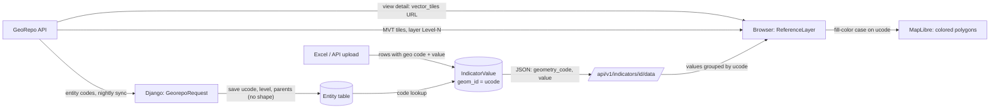

# Map path: GeoRepo boundary → colored polygon

All links are permalinks to commit [`516c4db`](https://github.com/callie-yuan/t4sg-unicef-h3/tree/516c4db786d48336f35694f975758ccb4cd7b204) (`h3-dev`).

**Short answer:** Django never sends boundary shapes. It stores only each region's *codes* (no geometry). The browser loads the shapes straight from GeoRepo as **vector tiles**, MapLibre draws them, and values are matched to shapes in the browser by **`ucode`** (or `concept_uuid`).

## 1. Trace

### a. Fetch
- **Client classes:** [`GeorepoUrl`](https://github.com/callie-yuan/t4sg-unicef-h3/blob/516c4db786d48336f35694f975758ccb4cd7b204/django_project/geosight/georepo/request/request.py#L154) builds URLs and auth headers. [`GeorepoRequest`](https://github.com/callie-yuan/t4sg-unicef-h3/blob/516c4db786d48336f35694f975758ccb4cd7b204/django_project/geosight/georepo/request/request.py#L350) makes the calls. Its nested [`ViewRequest`](https://github.com/callie-yuan/t4sg-unicef-h3/blob/516c4db786d48336f35694f975758ccb4cd7b204/django_project/geosight/georepo/request/request.py#L475) is `GeorepoRequest().View`.
- **Config:** the GeoRepo URL and API key are set in the admin (`SitePreferences`), not in env vars.
- **Main endpoints:**
  - [`GET /search/view/{uuid}/`](https://github.com/callie-yuan/t4sg-unicef-h3/blob/516c4db786d48336f35694f975758ccb4cd7b204/django_project/geosight/georepo/request/request.py#L316): view detail. Returns levels, countries and the `vector_tiles` URL.
  - [`GET /search/view/{uuid}/entity/identifier/{type}/{id}/`](https://github.com/callie-yuan/t4sg-unicef-h3/blob/516c4db786d48336f35694f975758ccb4cd7b204/django_project/geosight/georepo/request/request.py#L330): find one region by code.
  - `GET` entity lists per level (paginated), via `View.entities`.
  - `POST /operation/view/{uuid}/containment-check/...`: spatial matching for context layers.
  - `POST /search/view/{uuid}/entity/batch/identifier/{type}/`: batch code lookup during import.
- **The browser also calls GeoRepo directly** for vector tiles and `/search/view/{uuid}/centroid/`, adding the token in [`updateToken`](https://github.com/callie-yuan/t4sg-unicef-h3/blob/516c4db786d48336f35694f975758ccb4cd7b204/django_project/frontend/src/utils/georepo.jsx#L23).

### b. Store
- **Codes are saved locally; shapes are not.**
  - [`Entity`](https://github.com/callie-yuan/t4sg-unicef-h3/blob/516c4db786d48336f35694f975758ccb4cd7b204/django_project/geosight/georepo/models/entity.py#L50) stores [`geom_id`](https://github.com/callie-yuan/t4sg-unicef-h3/blob/516c4db786d48336f35694f975758ccb4cd7b204/django_project/geosight/georepo/models/entity.py#L73) (the GeoRepo ucode), `concept_uuid`, [`admin_level`](https://github.com/callie-yuan/t4sg-unicef-h3/blob/516c4db786d48336f35694f975758ccb4cd7b204/django_project/geosight/georepo/models/entity.py#L69) and [`parents`](https://github.com/callie-yuan/t4sg-unicef-h3/blob/516c4db786d48336f35694f975758ccb4cd7b204/django_project/geosight/georepo/models/entity.py#L53).
  - It has a [`geometry`](https://github.com/callie-yuan/t4sg-unicef-h3/blob/516c4db786d48336f35694f975758ccb4cd7b204/django_project/geosight/georepo/models/entity.py#L99) field, but the GeoRepo sync ([`sync_entities_code`](https://github.com/callie-yuan/t4sg-unicef-h3/blob/516c4db786d48336f35694f975758ccb4cd7b204/django_project/geosight/georepo/models/reference_layer.py#L183)) leaves it empty.
  - A Celery task re-syncs the codes nightly. There's no cache; shapes are fetched live by the browser.
- **Exception, local reference datasets:** the `reference_dataset` plugin *does* store geometry in PostGIS. It serves its own tiles with `ST_AsMVT`, one tile layer per admin level ([`vector_tile.py`](https://github.com/callie-yuan/t4sg-unicef-h3/blob/516c4db786d48336f35694f975758ccb4cd7b204/django_project/geosight/reference_dataset/utils/vector_tile.py#L46)).
- **Values:** [`IndicatorValue.geom_id`](https://github.com/callie-yuan/t4sg-unicef-h3/blob/516c4db786d48336f35694f975758ccb4cd7b204/django_project/geosight/data/models/indicator/indicator_value.py#L45) holds the ucode. Rows are [unique on `(indicator, date, geom_id)`](https://github.com/callie-yuan/t4sg-unicef-h3/blob/516c4db786d48336f35694f975758ccb4cd7b204/django_project/geosight/data/models/indicator/indicator_value.py#L130).

### c. Deliver
- **Format:** vector tiles (MVT), not GeoJSON. The URL comes from the view detail's [`vector_tiles`](https://github.com/callie-yuan/t4sg-unicef-h3/blob/516c4db786d48336f35694f975758ccb4cd7b204/django_project/frontend/src/pages/Dashboard/MapLibre/Layers/ReferenceLayer/index.tsx#L331) field.
- **Library:** [MapLibre GL `^4.7.1`](https://github.com/callie-yuan/t4sg-unicef-h3/blob/516c4db786d48336f35694f975758ccb4cd7b204/django_project/frontend/package.json#L108). deck.gl is used only for 3D extrusion.
- **Component:** `ReferenceLayer` in [`ReferenceLayer/index.tsx`](https://github.com/callie-yuan/t4sg-unicef-h3/blob/516c4db786d48336f35694f975758ccb4cd7b204/django_project/frontend/src/pages/Dashboard/MapLibre/Layers/ReferenceLayer/index.tsx#L353). It adds a `vector` source, reads tile layer [`"Level-" + currentLevel`](https://github.com/callie-yuan/t4sg-unicef-h3/blob/516c4db786d48336f35694f975758ccb4cd7b204/django_project/frontend/src/pages/Dashboard/MapLibre/Layers/ReferenceLayer/index.tsx#L342), and draws a [`fill` layer](https://github.com/callie-yuan/t4sg-unicef-h3/blob/516c4db786d48336f35694f975758ccb4cd7b204/django_project/frontend/src/pages/Dashboard/MapLibre/Layers/ReferenceLayer/index.tsx#L393).

### d. Join
- **Key:** [`ReferenceLayer/index.tsx:202-204`](https://github.com/callie-yuan/t4sg-unicef-h3/blob/516c4db786d48336f35694f975758ccb4cd7b204/django_project/frontend/src/pages/Dashboard/MapLibre/Layers/ReferenceLayer/index.tsx#L202-L204). It's `concept_uuid` if the project uses it, otherwise `ucode`.
- **Values grouped by code:** [`referenceLayer.jsx:142`](https://github.com/callie-yuan/t4sg-unicef-h3/blob/516c4db786d48336f35694f975758ccb4cd7b204/django_project/frontend/src/utils/referenceLayer.jsx#L142). The data's `geometry_code` is mapped to `ucode` by [`extractCode`](https://github.com/callie-yuan/t4sg-unicef-h3/blob/516c4db786d48336f35694f975758ccb4cd7b204/django_project/frontend/src/utils/georepo.jsx#L190).
- **Color applied:** [`ReferenceLayer/index.tsx:617-630`](https://github.com/callie-yuan/t4sg-unicef-h3/blob/516c4db786d48336f35694f975758ccb4cd7b204/django_project/frontend/src/pages/Dashboard/MapLibre/Layers/ReferenceLayer/index.tsx#L617-L630). This builds a MapLibre `case` expression: `["in", ["get", key], ["literal", codes]] → color`.
- ⚠️ Check this against D1-A's answer. D1-A isn't in the repo, so I couldn't compare.

### e. Plug-in point
- **Option A, new sibling layer:** add an `<H3Layer>` next to [`<ReferenceLayers>` in `MainMapLibre`](https://github.com/callie-yuan/t4sg-unicef-h3/blob/516c4db786d48336f35694f975758ccb4cd7b204/django_project/frontend/src/pages/Dashboard/MapLibre/MapLibre.tsx#L394). Context layers already render GeoJSON this way in [`geojsonLayer`](https://github.com/callie-yuan/t4sg-unicef-h3/blob/516c4db786d48336f35694f975758ccb4cd7b204/django_project/frontend/src/pages/Dashboard/MapLibre/LayerType/index.js#L55).
- **Option B, swap the source:** in `ReferenceLayer`, replace the vector source with `{type: "geojson", data: hexes}` and drop `source-layer`. The coloring code keeps working if each hex has a `ucode` (or `concept_uuid`) property holding its H3 index.

### f. Tests
- Tests never call the real GeoRepo:
  - Most patch [`Entity.get_entity`](https://github.com/callie-yuan/t4sg-unicef-h3/blob/516c4db786d48336f35694f975758ccb4cd7b204/django_project/geosight/importer/tests/importers/_base.py#L138) with [`mock_get_entity`](https://github.com/callie-yuan/t4sg-unicef-h3/blob/516c4db786d48336f35694f975758ccb4cd7b204/django_project/geosight/georepo/tests/mock.py#L20), which reads and writes the local DB instead.
  - Others use the `responses` library to return local JSON files for GeoRepo URLs ([`base_test_patch_responses.py`](https://github.com/callie-yuan/t4sg-unicef-h3/blob/516c4db786d48336f35694f975758ccb4cd7b204/django_project/core/tests/base_test_patch_responses.py#L49)).
- `georepo/api/mock/` doesn't exist. The mocks live in `georepo/tests/mock.py`.

## 2. Flow chart

## 3. Assumptions

| File:line | What it assumes | What breaks if the location is an H3 cell |
|---|---|---|
| [`ReferenceLayer/index.tsx:342`](https://github.com/callie-yuan/t4sg-unicef-h3/blob/516c4db786d48336f35694f975758ccb4cd7b204/django_project/frontend/src/pages/Dashboard/MapLibre/Layers/ReferenceLayer/index.tsx#L342) | Shapes come in tile layers named `Level-<admin level>` | H3 has resolutions, not admin levels, and GeoJSON has no `source-layer`, so nothing draws |
| [`ReferenceLayer/index.tsx:202`](https://github.com/callie-yuan/t4sg-unicef-h3/blob/516c4db786d48336f35694f975758ccb4cd7b204/django_project/frontend/src/pages/Dashboard/MapLibre/Layers/ReferenceLayer/index.tsx#L202-L204) | Join key is `ucode` or `concept_uuid` | Hexes must carry their H3 index under that property name, or no cell gets a color |
| [`indicator_value.py:45`](https://github.com/callie-yuan/t4sg-unicef-h3/blob/516c4db786d48336f35694f975758ccb4cd7b204/django_project/geosight/data/models/indicator/indicator_value.py#L45) + [`entity.py:73`](https://github.com/callie-yuan/t4sg-unicef-h3/blob/516c4db786d48336f35694f975758ccb4cd7b204/django_project/geosight/georepo/models/entity.py#L73) | Every value's location is a GeoRepo ucode with a matching `Entity` | H3 cells aren't entities, so import can't find them and rows are rejected |
| [`entity.py:333`](https://github.com/callie-yuan/t4sg-unicef-h3/blob/516c4db786d48336f35694f975758ccb4cd7b204/django_project/geosight/georepo/models/entity.py#L333) + [`term.py:17`](https://github.com/callie-yuan/t4sg-unicef-h3/blob/516c4db786d48336f35694f975758ccb4cd7b204/django_project/geosight/georepo/term.py#L17) | `parents` list length equals admin level, and level 0 is a country | An H3 cell's parent is a bigger hexagon, not a country, so the country stays empty |
| [`Request.tsx:186`](https://github.com/callie-yuan/t4sg-unicef-h3/blob/516c4db786d48336f35694f975758ccb4cd7b204/django_project/frontend/src/pages/Dashboard/LeftPanel/Indicators/Request.tsx#L184-L186) | Data requests need an `admin_level` and country codes | With no admin level or country, the browser never asks for the values |
| [`importers/base/indicator_value.py:563`](https://github.com/callie-yuan/t4sg-unicef-h3/blob/516c4db786d48336f35694f975758ccb4cd7b204/django_project/geosight/importer/importers/base/indicator_value.py#L563) | Values can be rolled up to parent regions via `parents` | H3 parents don't line up with district/province borders, so roll-ups would be wrong |
| [`worker.js:77`](https://github.com/callie-yuan/t4sg-unicef-h3/blob/516c4db786d48336f35694f975758ccb4cd7b204/django_project/frontend/src/pages/Dashboard/MapLibre/utils/DatasetGeometryData/worker.js#L77) | Labels and centroids come from GeoRepo's centroid file (with parent codes) | Hexes have no centroid file, so there are no labels and the search/zoom-to features break |

## 4. Open questions for UNICEF

1. Should hexes **replace** boundaries or be an **extra view** users toggle?
2. Which H3 **resolution(s)**? Fixed, or changing with zoom?
3. Will data arrive **already in H3**, or should we convert admin-level data to hexes? If we convert, how: spread evenly, by area, or by population?
4. Should hex values **roll up** to districts/countries (e.g. for country filters and summaries)?
5. Should hexes be **clipped** at country borders?
6. Does GeoRepo plan to support H3, or should GeoSight compute hexes itself?
7. Which countries come first? This decides how many cells we need to load. Fine resolutions may need vector tiles instead of GeoJSON.
